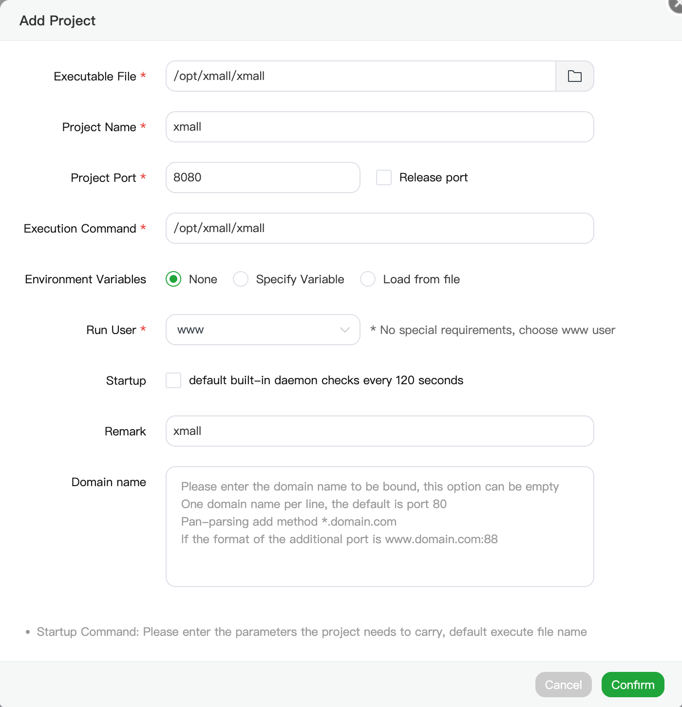

# XMall

XMall 是面向数字商品销售的全栈商城，包含 Go 后端、用户商城、管理后台和内置 Telegram Bot。正式发行包将两个前端嵌入同一个可执行文件，可通过单二进制部署，也可从源码构建 Docker 镜像。

本项目基于 Dujiao-Next 持续二次开发，重点改进数据库兼容性、Telegram 购物与履约、用户端体验，以及部署、更新和运维流程。XMall 为独立维护的非官方衍生版本。

[源码仓库](https://github.com/XManCodeing/XMall) · [版本下载](https://github.com/XManCodeing/XMall/releases) · [问题反馈](https://github.com/XManCodeing/XMall/issues) · [许可证](LICENSE)

## 功能概览

- **商城交易**：商品与 SKU、订单、支付、钱包、优惠券、卡密及自动履约。
- **业务管理**：商品与库存、采购与上游对接、分销、会员及运营配置。
- **用户体验**：多套商城模板、简体中文 / 繁体中文 / 英文、账号及第三方登录。
- **后台管理**：独立管理员认证、角色权限控制、TOTP 双重验证。
- **Telegram**：内置 Bot 实例管理、购物与支付、订单查询与交付、通知及群发。
- **部署运维**：SQLite / MySQL / PostgreSQL，单进程或 API / worker 分离运行，后台更新与重启。

## XMall 的主要改进

以下是本版的重点改动；具体发行版本包含哪些功能，以对应 Release 和提交记录为准。

### 数据库兼容与迁移

- 增加 MySQL 适配，保留 SQLite 和 PostgreSQL 支持。
- 数据库迁移引入版本记录，跳过已完成步骤并输出进度日志。
- 优化 MySQL 元数据查询及 decimal 默认值比较，减少重复迁移。

### 内置 Telegram Bot

- 将 Bot 运行、购物、支付和交付接入商城后端，不必另行运行外置购物机器人。
- 后台统一为「机器人实例管理」；旧「连接状态」和「Bot 客户端」地址跳转至该页面。
- 旧 Bot 客户端管理页面、`/api/v1/admin/channel-clients` 管理接口和旧客户端导入/接管流程已退役；原生实例不再依赖旧渠道归属记录。通用渠道认证及其他业务数据不在本次移除范围。
- 通过分布式租约、续租和取消链路控制多实例执行；发送结果不确定时保留待核对状态，避免盲目重发。
- 区分确定未提交网关与结果未知的支付失败，支持支付二维码原始内容及明确标注的二维码图片。
- 新增实例直接校验 Telegram Bot 身份；同一 Bot 只允许一个实例，配置版本冲突与重复实例返回明确提示。

### 用户端与运维体验

- 调整 Orbit 模板、登录表单及分组输入布局，补充 PC 导航中的登录和个人中心入口。
- 统一 XMall 安装包、安装管理脚本和更新源，避免误装其他项目的发行物。
- 改进后台更新流程：替换二进制后显式重启；支持 systemd 托管重启及符合条件的 Linux 原生进程 exec 重启。
- 提供 GitHub Actions 构建与草稿发布流程，发行包包含配置示例和许可证。

## 部署前准备

- **使用发行包**：无需安装 Go、Node.js 或前端构建工具。
- **数据库**：默认 SQLite；需要独立数据库时可配置 MySQL 或 PostgreSQL。
- **Redis**：基础服务可在关闭队列时运行；内置 Telegram Bot 和异步任务需要启用 `queue.enabled` 并配置可用的 Redis。`redis` 与 `queue` 是独立配置项。
- **公网访问**：准备域名、HTTPS 和反向代理，确认支付回调等地址能被外部访问。
- **已有部署**：先备份数据库、运行配置、上传文件，以及使用中的 Redis 队列；不要用新模板覆盖原配置。

### 配置文件

程序读取 `config.yml`；公开模板为 [config.yml.example](config.yml.example)。仅首次部署、配置尚不存在时复制：

```bash
cp -n config.yml.example config.yml
chmod 600 config.yml
```

编辑自己的 `config.yml`，至少确认以下项目：

- `app.secret_key`、`jwt.secret`、`user_jwt.secret`：分别运行一次 `openssl rand -hex 32`，填入三个不同随机值。已有部署不要随意更换 `app.secret_key`，否则可能无法解密存量数据。
- `bootstrap.default_admin_username`、`bootstrap.default_admin_password`：首次初始化的管理员账号与强密码。
- `server.host`、`server.port`：模板默认 `127.0.0.1:8080`；容器内应将监听地址改为 `0.0.0.0`。队列关闭时使用 `./xmall -mode api`；默认 `all` 模式需要启用队列并提供 Redis。
- `database`：数据库类型、连接信息及连接池；SQLite 保持单连接。
- `web.admin_path`：后台路径，默认 `/admin`。
- `server.trusted_proxies`、`cors.allowed_origins`：按实际代理与访问域名设置。
- `email`：需要邮件验证码等功能时配置 SMTP。
- `update.repository`：本项目为 `XManCodeing/XMall`；空字符串关闭远程更新。自行 fork 应指向自己的可信发行仓库。

不要提交运行配置、任何 `.env*`、密钥、数据库、日志或用户数据。

## 部署方式

已有 aaPanel 的 VPS 建议使用下方「方式二」，复用面板的 Nginx 和进程管理，不必再运行安装管理脚本。

### 方式一：发行包部署

从 [XMall Releases](https://github.com/XManCodeing/XMall/releases) 下载与系统、CPU 架构匹配的 `xmall_*` 安装包，并核对发布页提供的校验和。Linux / macOS 使用 `.tar.gz`，Windows 使用 `.zip`。请选择已公开的 XMall 发行物，不使用旧品牌附件代替。

解压至独立目录，按上文配置 `config.yml` 后，在该目录启动（默认 `all` 模式要求启用队列并提供 Redis；无队列时使用 `./xmall -mode api`）：

```bash
./xmall
```

Windows 使用 `xmall.exe`。首次启动会执行必要的数据库迁移；默认配置下可访问：

- 商城：`http://127.0.0.1:8080/`
- 后台：`http://127.0.0.1:8080/admin/`
- 健康检查：`http://127.0.0.1:8080/health`

生产环境应使用 systemd 或其他进程管理器保持运行，并通过反向代理提供 HTTPS。固定程序工作目录和运行身份，持久保存 `config.yml`、`db/`、`uploads/`；日志默认位于 `logs/`。

### 方式二：aaPanel 部署（已有面板推荐）

**发行包已经内嵌商城和管理后台，只需运行一个 `xmall` 程序。** 无需自行安装 Go、Node.js、PHP 或运行 Vue 开发服务器；若 aaPanel 的 Go 项目功能提示安装插件依赖，按面板要求处理。以下以 Linux、同机 Nginx、运行目录 `/opt/xmall` 为例，路径与端口请按实际调整。

部署后，访客通过域名访问 aaPanel 的 Nginx，由 Nginx 转发到 `127.0.0.1:8080`；XMall 一个进程提供商城、后台与 API，Go 项目负责进程管理。

下面使用 **aaPanel 8.0.4 英文界面的真实截图**，配合中文字段说明。截图中的路径和项目名为教程示例，未提交创建；服务器标识已脱敏。不同版本的入口名称可能略有区别，点击图片可查看大图。

> **先跑通本机，再配置域名。** 面板的管理端口不是商城端口；Nginx 代理目标是 XMall 的 `8080`，不是 aaPanel 登录地址。

#### 1. 下载并准备运行目录

1. 在 aaPanel 软件商店准备 Nginx；使用内置 Telegram Bot 和异步任务时，还需安装并启动 Redis。SQLite 无需单独安装数据库服务；MySQL / PostgreSQL 用户需提前创建数据库和专用账号。
2. 在 VPS 执行 `uname -m` 确认架构：`x86_64` 选择 `Linux_x86_64.tar.gz`，`aarch64` / `arm64` 选择 `Linux_arm64.tar.gz`。
3. 从 [最新正式发行版](https://github.com/XManCodeing/XMall/releases/latest) 下载对应安装包和 checksums 文件，使用 `sha256sum 安装包名` 与校验文件中的对应值完整比对。
4. 在独立临时目录解压，再通过面板文件管理器将程序、配置示例等文件放入 `/opt/xmall`。**不要把整个程序目录作为 Nginx 静态网站根目录**，避免配置、数据库、日志被公开访问。
5. 仅首次部署、没有现有配置时复制 `config.yml.example` 为 `config.yml`，按上文「配置文件」填写密钥、管理员账号和数据库连接。

Linux 程序权限设置为 `755`、运行配置设为 `600`。让实际运行用户拥有并可读配置、可写数据目录；不要通过 `chmod 777` 解决权限问题。相对路径 `db/`、`uploads/`、`logs/` 均以工作目录为基准，运行后不要随意更改工作目录。

#### 2. 配置端口、Redis 和队列

- 同机 Nginx 代理时，保留 `server.host: "127.0.0.1"`、`server.port: "8080"`；端口被占用时更换端口，并同步修改代理目标。
- 本机 Nginx 直连应用时，将 `server.trusted_proxies` 设置为 `["127.0.0.1", "::1"]`。如前面还有 CDN 或其他代理，按实际可信代理链配置，不直接信任所有来源。
- **完整商城 / Bot 部署**：设置 `queue.enabled: true`，正确填写 `queue.host`、`queue.port`、`queue.password`、`queue.db`。模板中的队列默认关闭，未配置就用默认模式启动会报 `queue disabled`。
- `redis` 是独立的缓存等功能配置，`queue` 是任务队列配置；启用 `redis.enabled` 不能代替启用队列。需要缓存时，另行填写 `redis` 下的连接参数。同一 Redis 服务可以使用不同 DB，已有站点不要随意更换 DB 或 key 前缀。
- 设置实际商城域名、支付回调地址及允许的跨域来源；`web.admin_path` 默认为 `/admin`，可按需修改。

Redis、数据库和应用端口无需对公网开放；外部访问统一经过 Nginx 的 HTTPS 入口。

#### 3. 在 aaPanel 添加 Go 项目

**先找入口：** 点击左侧 **Website（网站）**，切换顶部 **Go Project（Go 项目）**，再点击绿色 **Add Project（添加项目）**。


**再填表单：** 下图为真实的「Add Project」弹窗，已填入 `/opt/xmall` 部署示例。先核对运行目录、配置文件和权限，再点击 **Confirm（确认）**；不要照抄成其他目录的路径。



按截图从上往下填写：

- **Executable File（可执行文件）**：填写 `/opt/xmall/xmall`，选择已解压的 `xmall` 二进制，不选压缩包、源码目录或 `config.yml`。文件必须可执行。
- **Project Name（项目名称）**：填写 `xmall`，方便以后在项目列表中查找、停止和启动。
- **Project Port（项目端口）**：填写 `8080`，与 `server.port` 一致。`Release port` 表示放行端口，不是发布版本；同机 Nginx 代理时不勾选，无需公开 `8080`。
- **Execution Command**：完整部署运行 `/opt/xmall/xmall`，不要加 `&` / `nohup`。若面板已自动生成命令，核对后使用，不重复填写两遍可执行文件。只有明确不运行 worker 时才追加 `-mode api`；该模式不能单独运行内置 Bot。
- **Environment Variables**：本例选择 `None`，通过运行目录的 `config.yml` 配置；不需要额外的环境变量文件。
- **Run User**：当前面板默认 `www`，也可选择有权限的非 root 专用用户。配置文件设为 `600` 时，属主必须与运行用户匹配；程序目录及数据目录也必须允许该用户访问。
- **Startup / 守护**：启用所需的开机启动选项。当前弹窗提示内置守护默认每 `120` 秒检查一次，并不等于故障后立即恢复；实际行为以面板版本及项目设置为准。
- **Domain name**：可以先留空；填写时每行一个域名，例如 `shop.example.com`，不是 `https://shop.example.com/`。创建时已经绑定域名的，后续复用该站点配置 HTTPS，不再创建同域名的重复站点。

> **工作目录必须核对。** 当前 Go 项目新增弹窗没有独立的工作目录输入框，不要假定选择了可执行文件就一定正确。将 `config.yml` 与程序放在 `/opt/xmall`，创建后核对项目生成的启动配置或实际进程工作目录必须为 `/opt/xmall`。若当前面板无法保证，改用可显式设置工作目录的 Supervisor 托管，命令保持 `/opt/xmall/xmall`，工作目录填写 `/opt/xmall`，进程数为 `1`。两种方式只选一种。

**不要让 aaPanel 和另一套 systemd 服务同时启动它。** 如果曾在终端手动启动，请先停止临时进程再交给面板托管。已有 aaPanel 环境不要再执行下方安装管理脚本来「接管」，避免重复配置服务、Redis 或 Nginx。

启动后先查看面板项目日志和 `/opt/xmall/logs/`，再在 VPS 检查：

```bash
curl -fsS http://127.0.0.1:8080/health
```

首次启动需要执行数据库迁移；本机健康检查未通过前，先处理配置、端口、目录权限或数据库连接错误，不要靠反复改 Nginx 排查。

#### 4. 配置域名与 HTTPS 反向代理

复用 Go 项目已绑定的域名站点；若前一步留空，则在 aaPanel 添加或绑定商城域名。申请证书并开启 HTTPS，给根路径 `/` 配置反向代理：

- **代理目标**：`http://127.0.0.1:8080`（以实际应用端口为准）。
- **保留原始路径和域名**：商城、后台、`/api/`、`/uploads/` 都交给同一个 Go 服务，不单独映射前端目录。
- **传递请求信息**：保留 `Host`、客户端 IP 和 `X-Forwarded-Proto`，使应用正确识别域名与 HTTPS。
- **关闭代理缓存**：尤其登录、订单、支付及后台接口；移除会截获请求的 PHP / SPA 伪静态规则或默认静态文件匹配。
- **上传限制**：Nginx 的请求体大小限制应与应用实际上传限制匹配；收到 `413` 时检查面板的上传大小设置。

使用面板生成的代理配置时，检查对应规则即可，不要重复添加两个 `location /`。域名解析到 VPS，防火墙放行 `80/443`。完成后分别打开 `https://你的域名/`、实际后台路径和 `/health`；后台自定义路径由 `web.admin_path` 决定，不需要额外的 admin 静态站点。

#### 5. 升级与常见问题

**升级只换程序，不重新建站，也不重新生成密钥。**

按这个顺序操作：

1. 下载新版本并核对校验和。
2. 进入维护窗口，暂停业务写入，在 aaPanel 原 Go 项目中停止进程。
3. 一致性备份数据库、配置、上传文件、必要的队列状态和旧程序。
4. 上传新程序为 `xmall.new`，按下面命令保留旧程序并替换。
5. 核对属主与权限，在原 Go 项目中启动，检查日志及 `/health`。
6. 验收商城、后台、支付与 Bot 后恢复业务；失败时保持维护状态，先查错误，回滚前核对数据库兼容性。

升级前备份数据库、`config.yml`、上传文件、旧二进制及必要的 Redis 队列状态。SQLite 使用一致性备份，或停净写入后连同 WAL 状态正确处理；不要只复制运行中的 `.db`。将校验过的新程序上传为 `/opt/xmall/xmall.new`，**先在 aaPanel 停止进程**，再在运行目录替换：

```bash
cd /opt/xmall
# 确认进程已停止，且 xmall.new 来自已校验的新发行包
chmod 755 xmall.new
mv xmall "xmall.bak-$(date +%Y%m%d-%H%M%S)"
mv xmall.new xmall
```

检查新程序的属主和权限与原进程用户匹配，再从 aaPanel 启动。始终保留原 `config.yml`、`db/`、`uploads/` 和 `app.secret_key`；**不要把新安装包直接解压覆盖运行目录**。后台更新功能即使已替换二进制，也应确认重启结果；不能自动重启时在面板手动重启。

- **502**：先检查进程是否运行、本机 `/health` 是否可达，再核对代理端口。
- **`queue disabled` / Redis 连接失败**：检查队列开关、Redis 地址和密码；不要为了消除报错就把 Bot 部署改成 `-mode api`。
- **`address already in use`**：检查终端残留进程、重复托管或其他服务占用，不要再启动第二份程序。
- **看起来像空商城 / 图片丢失**：核对工作目录、数据库 DSN、上传目录和运行权限；不要重新初始化或清空数据库。
- **升级后仍显示旧版本**：确认面板的可执行文件路径和进程确实已重启。

最后验收商城、后台登录、订单、支付回调和 Bot。回滚前先确认数据库迁移兼容性，恢复旧二进制不等于恢复数据库；详细注意事项见 [发行与升级说明](doc/发行与升级.md)。

### 方式三：Linux 安装管理脚本

适用于 **Ubuntu 22.04+ / Debian 12+、systemd、amd64 / arm64** 的新部署。脚本配置 XMall、独立 Redis、Nginx、SQLite 和 HTTPS；不接管已有手动安装。开始前确认域名解析及 80 / 443 端口可用。

从本仓库取得源码后，先审阅 [scripts/xmall-manager.sh](scripts/xmall-manager.sh)，再执行：

```bash
sudo env XMALL_UPDATE_REPOSITORY=XManCodeing/XMall \
  bash scripts/xmall-manager.sh install
```

安装器要求所选仓库已有可下载的正式 Release；草稿和预发布版本不会被 latest release 接口选中。没有符合要求的发行包时，先完成发布或使用源码构建，不切换到其他项目的更新源。

安装后常用命令：

```bash
sudo xmall-manager status
sudo xmall-manager logs app
sudo xmall-manager restart
sudo xmall-manager configure-domain
sudo xmall-manager configure-admin-path
sudo xmall-manager admin-reset-password
sudo xmall-manager admin-reset-2fa
```

应用目录为 `/opt/xmall`，安装状态位于 `/etc/xmall`，卸载备份位于 `/var/backups/xmall`。重新执行安装流程时仍需显式传入 `XMALL_UPDATE_REPOSITORY`。

### 方式四：自行构建 Docker 镜像

仓库保留 [Dockerfile](Dockerfile) 供自行构建，不提供官方预构建镜像，也不再维护 Docker 内测或镜像发布工作流。推荐使用 Release 安装包；如需自行构建：

```bash
docker build --build-arg APP_VERSION=local -t xmall:local .
```

先准备宿主机 `config.yml`，将 `server.host` 改为 `0.0.0.0`，保持端口 `8080`；然后运行：

```bash
docker run -d --name xmall --restart unless-stopped \
  -p 127.0.0.1:8080:8080 \
  --mount type=bind,src="$(pwd)/config.yml",dst=/app/config.yml,readonly \
  --mount type=volume,src=xmall-db,dst=/app/db \
  --mount type=volume,src=xmall-uploads,dst=/app/uploads \
  --mount type=volume,src=xmall-logs,dst=/app/logs \
  xmall:local ./xmall -mode api
```

此示例供宿主机反向代理访问，不直接公开应用端口，使用 `api` 模式且不运行后台 worker。**需要内置 Telegram Bot 或异步任务时**，先配置可达的 Redis 和 `queue.enabled: true`，再将最后一行改为 `xmall:local`，使用默认 `all` 模式；仅运行上述 API 示例不能代替完整 Bot 部署。Redis 和外部数据库需另行提供，容器内的 `127.0.0.1` 不指向宿主机。容器升级使用新镜像重建，保留数据卷，不使用容器内二进制自更新。

## Telegram 实例启用

先配置 Redis 队列，再通过后台创建 Bot 实例、填写 Token、设置菜单及业务配置。创建时验证 Telegram 身份，实例默认停用，配置完成后再启用。

旧客户端归属与导入/接管接口已退役，不再作为新实例创建或启动的前置条件。旧渠道记录即使仍保存在数据库中，也不参与原生实例归属判定；程序不会因此自动删除历史订单、用户或交易记录。

同一个 Bot 不应同时运行外部 polling 程序与内置实例。若曾实际运行外置机器人，先停用旧进程与凭据、核对未完成交易和消息任务，再启用新实例；本项目不再提供自动接管工具。已有 webhook 仍会阻止启用 polling，不自动删除 webhook 或丢弃消息。

支付二维码默认按原始内容本地编码，不探测普通支付 URL。返回图片地址的网关需在渠道配置 JSON 声明 `"telegram_qr_code_kind": "image"`，或返回 `qrcode_type: "image"`；响应中的明确类型优先。图片获取失败仅回退到独立收银台链接，不把图片地址当成支付码。

## 更新、备份与常用运维

### 更新流程

1. 阅读目标版本说明，备份数据和配置；启用内置 Bot 前确认没有同 Bot 的旧外部进程运行。
2. 使用本项目发行包或后台更新功能，核对目标版本及更新源。
3. 后台更新替换二进制后，点击「立即重启」。systemd 部署遵循其重启策略；符合预检条件的 Linux 非 systemd 原生部署使用 exec；其他环境手动重启。
4. 检查 `/health`、实际版本、后台登录、订单及任务处理，再恢复业务。

重启会短暂中断服务，不是零停机升级。旧程序首次升级到支持 exec 的版本时需要先手动重启。更新失败或新版本启动失败不会自动回滚数据库；不要仅替换旧二进制就假定迁移已撤销。

### 运行模式与管理员恢复

```bash
./xmall                  # 默认：HTTP 服务 + worker
./xmall -mode api        # 仅 HTTP 服务
./xmall -mode worker     # 仅后台 worker，需要启用队列

./xmall admin list-admins
./xmall admin reset-password
./xmall admin reset-2fa
```

多进程部署须保持数据库、队列及加密密钥一致。备份不仅包含程序文件：SQLite 需使用一致性备份方式，独立数据库使用对应备份工具，启用队列时同时考虑 Redis 状态；恢复前核对支付及发送结果，避免重复执行。

## 本地开发

技术栈：Go 1.26.5、Gin、GORM；Vue 3、TypeScript、Vite、Tailwind CSS v4；Redis / asynq；JWT、Casbin 和 TOTP。前端工具链与 CI 对齐为 Node.js 24.11.1、pnpm 10.34.3，可通过 Corepack 启用 pnpm。

准备私有 `config.yml`。**当前两个前端开发代理均指向 `127.0.0.1:8088`**，开发时将后端 `server.port` 设为 `8088`，并按需允许前端地址跨域。分别在三个终端运行：

```bash
# 仓库根目录：API 服务，不内嵌前端
go run ./cmd/server
```

```bash
cd frontend/user
pnpm install --frozen-lockfile
pnpm run dev
# 用户端：http://localhost:6173
```

```bash
cd frontend/admin
pnpm install --frozen-lockfile
pnpm run dev
# 管理后台：http://localhost:6174
```

### 目录与开发约定

- `cmd/server/`：服务入口及管理员运维命令。
- `internal/modules/`：按业务模块划分的领域、应用、接口和基础设施实现。
- `internal/app/`、`internal/bootstrap/`：依赖装配、路由和后台任务。
- `internal/architecture/`：模块依赖和代码结构约束测试。
- `frontend/user/`、`frontend/admin/`：用户商城与管理后台。
- `internal/web/`：前端嵌入与路由挂载。
- `scripts/`、`.github/workflows/`：安装、检查与发布脚本。

后台路径由 `web.admin_path` 在运行时决定，前端原生链接使用现有 `adminUrl()` 工具。新增后台接口需同步维护角色权限及覆盖测试。数据库事务内使用事务绑定的存储，不调用全局数据库连接；SQLite 单连接下混用会导致等待。

### 构建与测试

仅构建 API 服务：

```bash
go build -o xmall ./cmd/server
```

构建含两个前端的本机快照，使用 GoReleaser v2（需已安装 Go、Node.js 和 pnpm）：

```bash
goreleaser build --snapshot --single-target --clean
```

构建配置自动安装锁定依赖、构建两个前端并嵌入。后台必须使用 `build:fullstack`，不能以普通 `build` 代替；直接使用 `-tags release,fullstack` 编译前必须先准备两份前端产物。

常用检查：

```bash
go mod tidy -diff
go vet ./...
go test ./...
go test -race ./internal/...
(cd frontend/admin && pnpm test && pnpm run build:fullstack)
(cd frontend/user && pnpm test && pnpm run build)
```

本地测试不替代真实支付、Telegram Bot、目标数据库及服务器环境的验收。

## 构建与发布

本版变更、升级注意事项和维护者发行步骤见 [发行与升级说明](doc/发行与升级.md)。

[GitHub Actions 发布工作流](.github/workflows/release.yml) 和 [GoReleaser 配置](.goreleaser.yaml) 是本项目发行流程的依据：

1. 手动运行 `goreleaser` 工作流，执行输入检查、安装脚本检查、后端与前端测试，生成快照附件，不创建正式 Release。
2. 对通过验证的提交推送独立 `v*` tag，生成包含 Linux / Windows / macOS、amd64 / arm64 产物和校验和的草稿 Release。
3. 核对目标系统安装与启动、版本信息、源码及许可证后，手动公开草稿。

安装包工作流使用 `GITHUB_TOKEN`，需要 `contents: write` 权限。本项目不提供官方 Docker 镜像，不再维护 GHCR 发布或内测工作流；发行使用上述安装包流程。原有 `Dockerfile` 仅保留供自行构建，不代表提供镜像发布服务。发行物应对应明确 tag / commit，并提供完整对应源码、构建材料和许可文件；运行密钥和业务数据不属于发行材料。

## 致谢与许可证

感谢 [Dujiao-Next](https://github.com/dujiao-next/dujiao-next) 及其贡献者提供的项目基础，也感谢所使用的开源组件。原项目资料可参考 [上游文档](https://dujiao-next.com)，XMall 的部署与行为以本仓库和对应发行版本为准。

本工作副本自 2026-10-26 起记录二次开发修改，主要改动见上文及提交历史；原始导入的准确上游 tag / commit 尚待核验，不将来源目录名视为已确认版本。XMall 不代表上游维护者或其合作伙伴。

本衍生项目依照 **GNU GPL v3** 发布，详见 [LICENSE](LICENSE)。保留上游及其他权利人的版权、许可和免责声明；第三方组件遵循各自许可证。发布修改版或构建产物时须提供相应源码与许可材料。本软件不附带担保。
